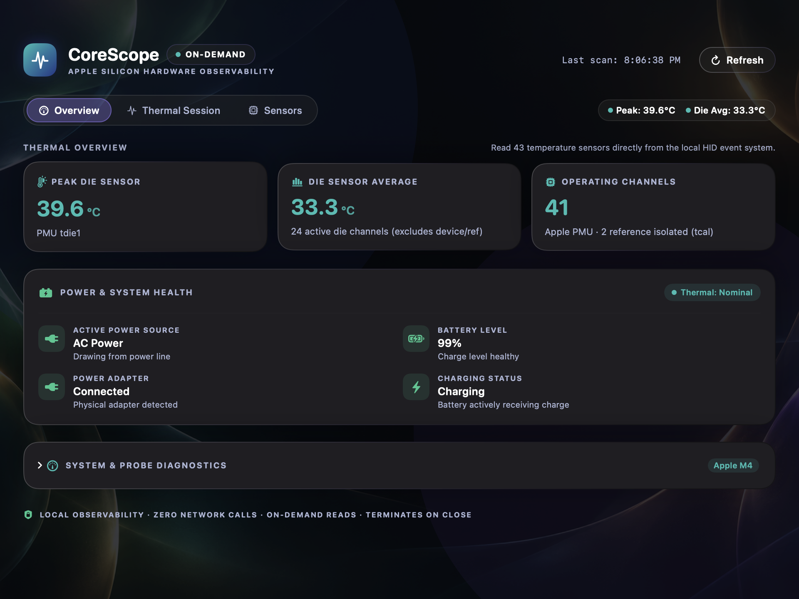
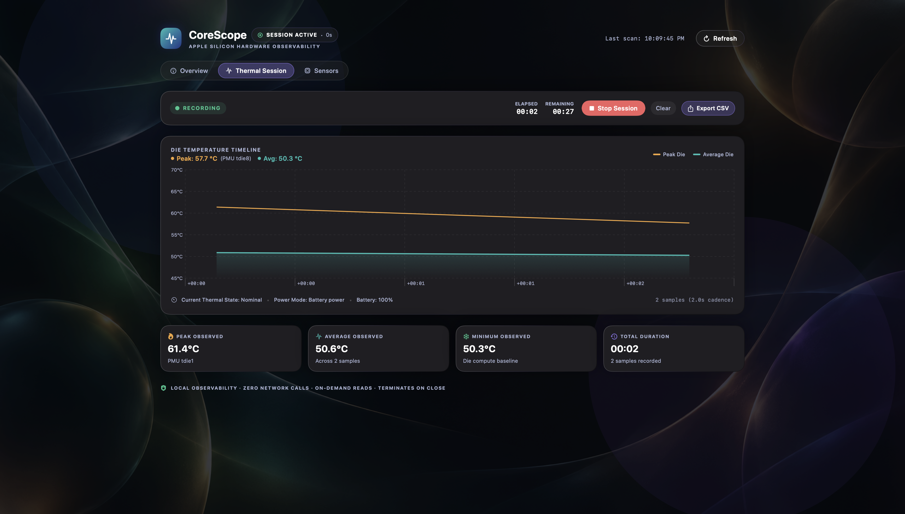
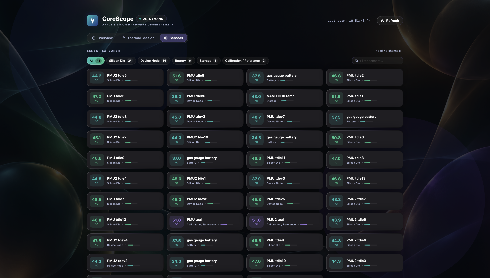

# CoreScope

A native, on-demand hardware observability dashboard designed specifically for Apple Silicon Macs. CoreScope reads genuine power-management unit (PMU) die temperatures, device thermal nodes, battery telemetry, and AC/DC power-source states directly from local macOS system frameworks without external dependencies, background daemons, or root privileges.

---

## Interface Preview

### 1. Midnight Liquid Glass Dashboard Overview


### 2. User-Controlled Thermal Recording Session (Live Swift Charts)


### 3. Hardware Sensor Explorer & Category Filter


---

## Core Features

- **Genuine Hardware Telemetry**: Directly enumerates Apple Silicon PMU thermal nodes via `IOHIDEventSystemClient` (`0xFF00:0x05`) resolved against system IOKit. Never estimates, fabricates, or simulates temperatures.
- **Truthful Sensor Categorization**:
  - **Silicon Die (`tdie`)**: Compute complex sensors across CPU/GPU cores and SoC fabric.
  - **Device Nodes (`tdev`)**: Peripheral power-management nodes across the logic board.
  - **Battery (`battery` / `gas gauge`)**: Battery pack thermal sensors.
  - **Storage (`nand` / `storage`)**: NVMe and NAND flash storage controller sensors.
  - **Calibration / Reference (`tcal`)**: Reference channels reported by Apple PMU firmware, strictly isolated from operating die averages.
- **User-Controlled Thermal Sessions**:
  - Optional, active periodic recording with a disciplined **2.0-second sampling interval**.
  - Configurable durations: **30 seconds**, **2 minutes**, **5 minutes**, or **Manual stop**.
  - Live hardware temperature visualization using native **Swift Charts** (peak die in amber, average die in teal with area gradient).
  - In-memory summary statistics: peak observed temperature, overall average, minimum die baseline, sample count, and recorded duration.
  - **Strict Non-Overlapping Probing**: Collisions are prevented by design (`isSamplingInProgress` guard).
  - **In-Memory Privacy**: Zero automatic file writing, zero databases, and zero telemetry. All session data resides in RAM until explicitly exported or cleared.
  - **Native RFC 4180 CSV Export**: User-triggered export via `NSSavePanel`. Automatically sanitizes and excludes usernames, home directory paths, serial numbers, and machine identifiers.
- **Power & Battery Health**: Reads active power mode (AC power vs. battery discharge), physical adapter connection, charging state, and battery percentage via `IOPowerSources` (`IOKit.ps`). Charging status is reported separately from adapter presence.
- **Midnight Liquid Glass Aesthetic**:
  - Deep midnight near-black base surface with static indigo-blue and violet illumination pools.
  - Translucent floating glass cards with subtle specular reflections and restrained violet tint.
  - Clear white primary typography and muted lavender secondary labels.
  - Full support for macOS accessibility features (Reduce Transparency and Reduce Motion).
- **Three-Section Native Navigation**: Effortlessly switch between `Overview`, `Thermal Session`, and `Sensors` using a compact segmented control.
- **Native macOS App Icon**: Liquid-glass squircle icon compiled from 1024×1024 source artwork into native multi-resolution `AppIcon.icns`.
- **Safe Local Asset Architecture**: Zero crash-prone `Bundle.module` access. Resolves `CoreScopeAmbient.png` locally with graceful dark-mode gradient fallback.
- **On-Demand & Stateless**: Normal monitoring runs off the UI thread upon launch or explicit user refresh. No continuous background polling, zero menu-bar extras, zero background daemons, and measured **0.0% idle CPU**.
- **Clean Exit**: Closing the window cleanly cancels any active session and terminates the application process.

---

## Requirements

- **Target Hardware**: Apple Silicon Mac (M1, M2, M3, M4 series). Tested on Apple MacBook Air (`Mac16,13`, Apple M4).
- **Operating System**: macOS 13.0 (Ventura) or later.
- **Development Toolchain**: Xcode 15+ or Swift 6.0+ toolchain.
- **Offline Integrity**: Zero external package dependencies (`dependencies: []`). Builds completely offline.

---

## Installation & Execution Paths

CoreScope provides two separate execution paths: building directly from source or packaging a standalone macOS application bundle.

### Path A: Build and Run from Source (Recommended for Developers)

1. Clone the repository and navigate to the project directory:
   ```sh
   git clone https://github.com/shrihaan-arora/CoreScope.git
   cd CoreScope
   ```

2. Run the native SwiftUI application:
   ```sh
   swift run CoreScope
   ```

3. Or run the headless CLI probe in Terminal to inspect raw sensor channels:
   ```sh
   swift run CoreScope --cli
   ```

*Note on compatibility*: Temperature-sensor channel availability and descriptor names depend on the host Apple Silicon generation and macOS version. Intel Macs use legacy SMC keys and are not supported by this HID-based probe.

---

### Path B: Package a Local Standalone Application (.app)

CoreScope includes a reproducible packaging script that compiles the release binary, creates a standard macOS application bundle (`build/CoreScope.app`), bundles the local ambient asset into `Contents/Resources/`, generates `Info.plist`, applies an ad-hoc code signature, and creates an archive (`build/CoreScope-1.0.0.zip`):

```sh
./scripts/package-app.sh
```

Launch the local application bundle:
```sh
open build/CoreScope.app
```

#### Code Signing & Gatekeeper Notice

> [!IMPORTANT]
> **Ad-Hoc Signing vs. Notarized Public Releases**:
> The local packaging script (`scripts/package-app.sh`) applies an **ad-hoc signature** (`codesign --sign -`) to establish bundle integrity solely on your local build machine. Ad-hoc signing does **not** provide Apple Developer ID credentials or Gatekeeper notarization.
>
> If you transfer an ad-hoc packaged application bundle to another Mac, macOS Gatekeeper will block execution. **Do not disable macOS security protections or strip quarantine attributes to run untrusted binaries.** To run CoreScope on other machines, either compile it directly from source via `swift run CoreScope` or use the official Developer ID signing and notarization pipeline described below.

---

## Developer ID Signing & Apple Notarization Pipeline

For maintainers producing public binary releases for distribution across macOS systems, CoreScope includes an automated, credential-safe notarization script:

```sh
./scripts/notarize-app.sh
```

### Authentication Options
1. **Keychain Profile (Recommended)**:
   ```sh
   xcrun notarytool store-credentials "CoreScopeNotary" \
     --apple-id "developer@example.com" \
     --team-id "YOUR_TEAM_ID" \
     --password "app-specific-password"

   KEYCHAIN_PROFILE="CoreScopeNotary" \
   DEVELOPER_ID="Developer ID Application: Your Name (TEAMID)" \
   ./scripts/notarize-app.sh
   ```

2. **App Store Connect API Key**:
   ```sh
   API_KEY_PATH="/path/to/AuthKey_XXXX.p8" \
   API_KEY_ID="XXXX" \
   API_KEY_ISSUER="xxxxxxxx-xxxx-xxxx-xxxx-xxxxxxxxxxxx" \
   DEVELOPER_ID="Developer ID Application: Your Name (TEAMID)" \
   ./scripts/notarize-app.sh
   ```

The script automatically enforces hardened runtime (`--options runtime`), submits to Apple Notary Service via `xcrun notarytool`, staples the ticket (`xcrun stapler staple`), and verifies Gatekeeper compliance (`spctl --assess`).

---

## Automated Testing

CoreScope separates deterministic unit tests from physical hardware integration tests. Virtualized CI environments (such as GitHub Actions `macos-latest` runners) lack physical Apple Silicon PMU hardware and do not emulate the private HID thermal usage page (`0xFF00:0x05`). Therefore, live sensor probes are gated behind an opt-in environment variable.

### 1. Standard Deterministic Test Suite (Developers & CI)

Runs all deterministic unit tests (sensor classification, count conservation, summary mathematics, missing-category handling, power-source parsing, safe asset loading, Thermal Session lifecycle, duration auto-termination, overlapping scan prevention, statistics calculations, and RFC 4180 CSV escaping) without requiring physical hardware:

```sh
swift test
```

*Note*: Live sensor tests are automatically skipped in this mode with an explicit explanation:
`➜ Test testSensorProbeSnapshotLive() skipped: "Requires physical Apple Silicon PMU sensor access (set CORESCOPE_REQUIRE_LIVE_SENSORS=1)"`

### 2. Physical Hardware Integration Suite (Apple Silicon Host)

When running on physical Apple Silicon hardware (such as an Apple M4 MacBook Air), enable the live sensor suite to test real PMU node enumeration, live temperature ranges, channel exclusivity, and M4 baseline channel verification:

```sh
CORESCOPE_REQUIRE_LIVE_SENSORS=1 swift test
```

When `CORESCOPE_REQUIRE_LIVE_SENSORS=1` is specified, missing sensor data produces a genuine test failure.

---

## Hardware Telemetry Architecture

### PMU Temperature Sensors
Apple Silicon exposes hardware thermal nodes via the local IOKit HID Event System. CoreScope queries `IOHIDEventSystemClient` with matching criteria for the Apple vendor usage page (`0xFF00`, usage `0x05`). Each matching service provides:
- Live die temperature (`IOHIDServiceClientCopyEvent` with `kIOHIDEventTypeTemperature`).
- Hardware node descriptor (`IOHIDServiceClientCopyProperty` with `Product`).
- Subsystem categorization (`tdie`, `tdev`, `battery`, `nand`, `tcal`).

Sensor handles follow an on-demand lifecycle: `IOHIDEventSystemClient` is created for each scan and released immediately upon completion. When idle, zero sensor clients, threads, or timers remain open. During an active Thermal Session, reads execute asynchronously on a fixed 2.0-second interval with an in-flight guard to prevent overlapping hardware probes.

### Hardware Limitations & Truthful Reporting
- **Channel Identifiers**: Nodes are reported under their genuine Apple PMU channel names (e.g. `PMU tdie1`, `PMU tdev4`, `gas gauge battery`). Apple does not publicly document fixed mappings between PMU channel names and CPU/GPU core numbers; CoreScope displays authentic raw descriptors rather than inventing core assignments.
- **Calibration Channels (`tcal`)**: Reference channels are classified separately and excluded from operating summaries. CoreScope does not speculate on PMU calibration register designs without official technical documentation.
- **Passive Telemetry**: CoreScope is an observability dashboard; it does not control fan speeds, throttle clock rates, or alter hardware power states.

---

## Security & Privacy Model

- **Local-Only by Design**: CoreScope makes no intentional app-level network requests, has no telemetry or analytics SDKs, requires no accounts, and connects to no cloud services.
- **In-Memory Data Handling**: Thermal session recordings remain exclusively in volatile memory. CSV exports only occur after explicit user selection via a native macOS save dialog.
- **Scope of Claims**: The offline architecture minimizes external exposure, but no software can promise absolute immunity against all memory defects, system-level bugs, or local macOS security boundary issues.
- **Reporting Vulnerabilities**: Suspected security issues should be reported confidentially via [GitHub Security Advisories](https://github.com/shrihaan-arora/CoreScope/security/advisories). See [SECURITY.md](SECURITY.md).

---

## Contributing & License

Contributions that adhere to the dependency-free, local-only architecture are welcome. Please ensure all changes pass `swift test` and maintain clean code formatting.

CoreScope is licensed under the [MIT License](LICENSE).
Third-party architectural references and notices are documented in [THIRD_PARTY_NOTICES.md](THIRD_PARTY_NOTICES.md).
